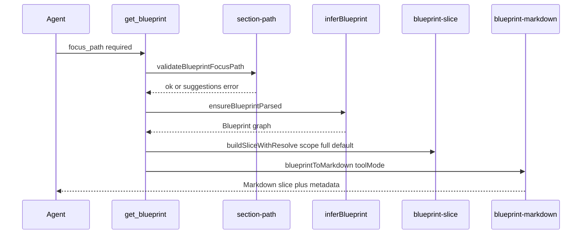

# Atlarix architecture — Live Code Map & parsers

Technical reference for how Atlarix builds the **Live Code Map** (in-product **Blueprint** graph) and related structural tooling. This is internal architecture documentation—not marketing copy.

## Live Code Map (Blueprint graph)

**Blueprint on demand.** Atlarix builds a Blueprint graph when the agent calls `get_blueprint` or uses structural `search` — not by injecting the whole repo every turn. The model loads focused slices from the graph instead of scanning hundreds of thousands of raw tokens.

### Index stack (v8.6+)

| Layer | Engine | Role |
| --- | --- | --- |
| **Symbol index** | **Universal Ctags** (bundled per platform) | Functions, classes, types — line-accurate beacons |
| **Structural graph** | **@ast-grep/napi** | Import, call, and HTTP route edges (TS/JS/TSX/**Python/Go**; Express/Fastify/Next) |
| **Natural language** | **BM25** (`wink-bm25-text-search`) | Ranks ctags symbols by concept query |
| **Text fallback** | **ripgrep** | Exact string / pattern search |

**Fallback:** When ctags or ast-grep is unavailable, `generateBlueprint()` falls back to the file-tree bridge (directory beacons + regex import edges).

**Lazy load (v8.6+):** `get_blueprint` → `inferBlueprint` tries RTE disk cache, then `generateBlueprint()` (ctags + ast-grep), then file-tree, then workspace analysis.

**Section-scoped tool (v8.7+):** The agent must pass **`focus_path`** (workspace-relative folder). `validateBlueprintFocusPath` rejects missing paths and suggests close matches. After parse, `buildSliceWithResolve` defaults to **`scope: "full"`** for that section (auto-widen if a narrow slice would be empty). Output is **tool-mode Markdown** with `parseQuality` / `parseEngine` metadata.

**Richness-gated merge (v8.7+):** When ctags/ast-grep output is thin, `supplementThinRteResult` and `mergeBlueprintWithFileTree` backfill structure; engine may be **`hybrid`**. Empty parses are **not** written to cache.

**Removed:** oxc-parser, tree-sitter WASM, and per-language RTE parsers — replaced by ctags + ast-grep.

**Deep reference:** [ATLARIX_RTE_BLUEPRINT_REFERENCE.md](ATLARIX_RTE_BLUEPRINT_REFERENCE.md).

### Product surfaces

- **Live View** — Diagram extracted from your codebase (Mermaid). Read-only architecture visualization.
- **Blueprint Mode** — Add containers, beacons, and edges; compare desired vs actual; generate `.atlarix/ATLARIX_PLAN.md`.
- **Incremental Updates** — File watcher runs **per-file** ctags + ast-grep refresh (not full-project rebuild).
- **Blast radius** — Blueprint BFS over flow edges before `write_file` / `edit_file` approvals (guided/build only; skipped in autonomous auto-approve) and via `diagnose_issue` (`change_impact`).
- **Combined Blueprints** — Polyrepo / monorepo: one view with cross-project edges.
- **`.atlarixignore`** — Gitignore-syntax exclusions from parsing, Blueprint nodes, and prompt injection.

### Parser pipeline

1. `getProjectFiles()` — git ls-files / fd / ripgrep cascade.
2. `ensureSymbolIndex()` / `updateSymbolIndexForFile()` — Universal Ctags JSON → `.atlarix/symbols.json`.
3. `runStructuralScan()` — ast-grep import/call/**route** rules (dynamic Python/Go grammars via `@ast-grep/lang-*`) → RTE edges.
4. `rteResultToBlueprint()` — cluster symbols into rooms/beacons.
5. Richness gate → optional hybrid supplement + file-tree merge (`blueprint-quality.ts`, `blueprint-merge.ts`, `rte-supplement.ts`).
6. `buildSliceWithResolve()` — section slice (`blueprint-slice.ts`).
7. `blueprintToMarkdown({ toolMode: true })` — compact model-facing slice.

### v8.7 tool flow (`get_blueprint`)

### Tools

- `get_blueprint` — section-scoped lazy fetch; **`focus_path` required**; preflight path validation; default **`scope: "full"`**; tool-mode Markdown; optional `include_raw` / `graph` when thin.
- `get_diagram` — Mermaid architecture/flow views on demand.
- `get_file_outline` — ctags-backed symbol TOC per file (regex fallback).
- `search({ mode: "structural" })` — ast-grep / blueprint graph queries.
- `search({ mode: "semantic-graph" })` — BM25 over ctags symbols.
- `search({ mode: "text" })` — ripgrep.
- `commit_blueprint` — Workforce tier; writes `.atlarix/blueprint.json` with approval.

See [CHANGELOG.md](CHANGELOG.md) for release-specific parser and packaging notes.
