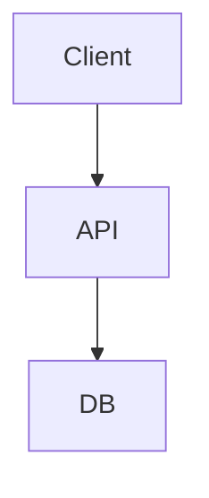
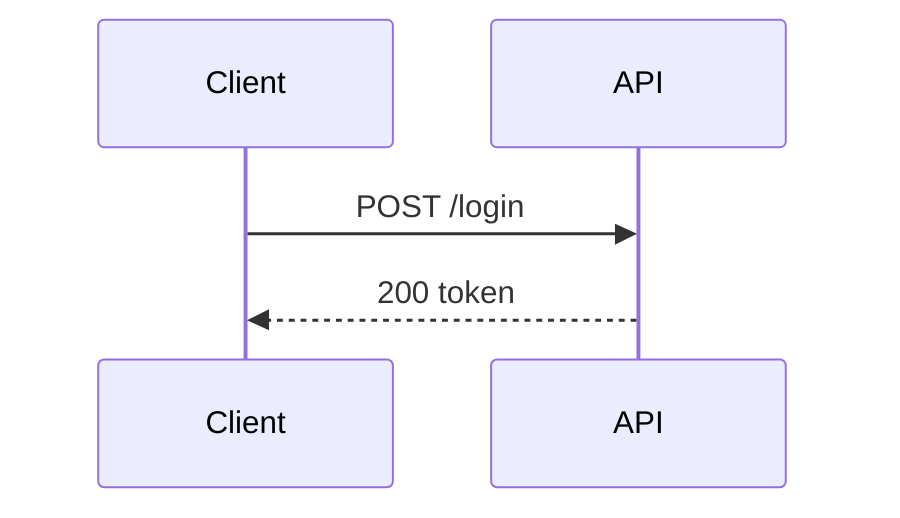
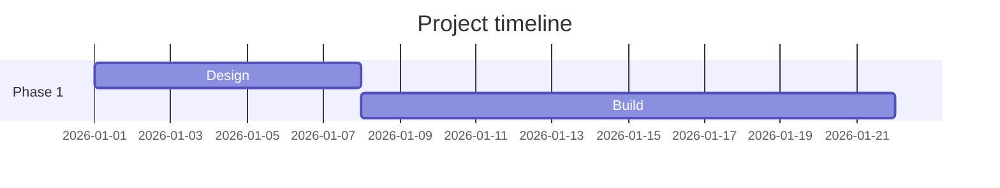

# Visual Artifacts (chat)

Atlarix renders tables, charts, mermaid diagrams, and markmaps **inline** as collapsible artifact cards. Put the visual in the **same reply** as your explanation—do not ask the user to open a side panel.

Use **one** primary visual per answer unless the user asked for multiple views.

## Decision matrix

| Situation | Use | Do not use |
|-----------|-----|------------|
| Multi-column rows (names, statuses, dates, text fields) | GFM **markdown table** | ASCII grid, chart fence |
| Numeric series, rankings, counts, metrics | ` ```chart ` JSON fence | ASCII bar art, table with one numeric column |
| Request/response flow, sequence, state machine, class/ER, dependencies | ` ```mermaid ` | markmap for flows |
| Timelines, Gantt schedules | ` ```mermaid ` with `gantt` | chart fence for dates |
| Repo/folder tree, module outline, doc hierarchy, brainstorm branches | ` ```markmap ` | mermaid for pure hierarchies |
| After `get_diagram` | Echo `mermaid_code` in ` ```mermaid ` | Paraphrase without the fence |

## Tables

Atlarix wraps GFM tables in a collapsible **Table** artifact card.

```markdown
| Service | Errors | Owner |
|---------|--------|-------|
| api     | 12     | team-a |
| worker  | 4      | team-b |
```

Rules:
- Use a header row and alignment row (`|---|---|`).
- Prefer tables when columns mix text types or when exact values matter.
- Do not use tables for a single numeric series—use a chart instead.

## Charts (` ```chart `)

Atlarix wraps charts in a collapsible artifact card. **Always set `title`** for the card header.

```chart
{
  "type": "bar",
  "title": "Dominant themes",
  "labels": ["Motivation", "Discipline", "Resilience"],
  "values": [43, 32, 28]
}
```

Schema:
- `type`: `"bar"` or `"line"` (default `"bar"`)
- `title`: string (required for good UX)
- `labels`: string array
- `values`: number array (same length as `labels`)

## Mermaid diagrams (` ```mermaid `)

Atlarix wraps diagrams in a collapsible artifact card with pan/zoom.

Supported types include: `flowchart`, `sequenceDiagram`, `classDiagram`, `erDiagram`, `stateDiagram-v2`, `gantt`, `pie`, etc.

Rules:
- First non-comment line must declare the diagram type.
- Node IDs: no spaces—use `camelCase` or `snake_case`.
- Labels with spaces/special chars: `A["Process (main)"]`
- After `get_diagram`, always echo returned `mermaid_code` in a mermaid fence.

**Flowchart example:**



**Sequence example:**



**Gantt example:**



## Markmap (` ```markmap `)

Atlarix wraps mind-maps in a collapsible artifact card. Use one root `#` heading as the title.

```markmap
# My App
## API
- routes
- handlers
## UI
- components
```

Rules:
- Use markdown headings (`#`, `##`) and bullet lists.
- One root `#` title drives the artifact card header.
- Prefer markmap for hierarchies; prefer mermaid for flows and interactions.

## Streaming

- Finish the closing ``` on every fence before continuing prose.
- Do not emit partial JSON in chart fences.
- Do not split a single diagram across multiple messages.

## Anti-patterns

- Do not use ASCII art bar charts or grids.
- Do not ask "Would you like a diagram?" when you can show one now.
- Do not wrap fences in prose without the actual fence block.
- Do not use ` ```chart ` for non-numeric data.
